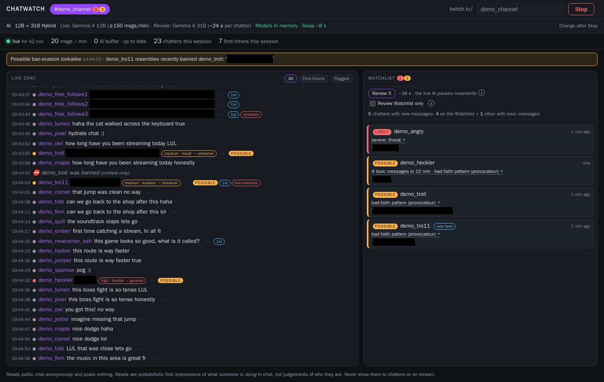
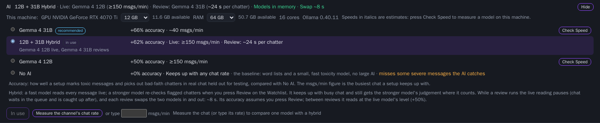
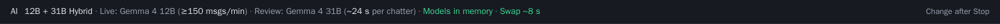
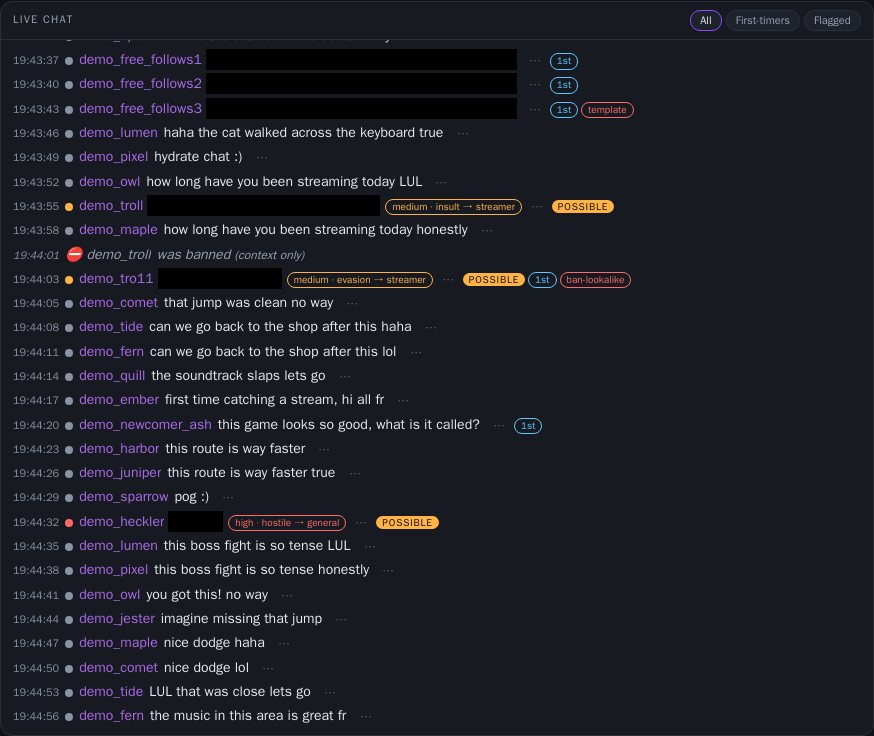
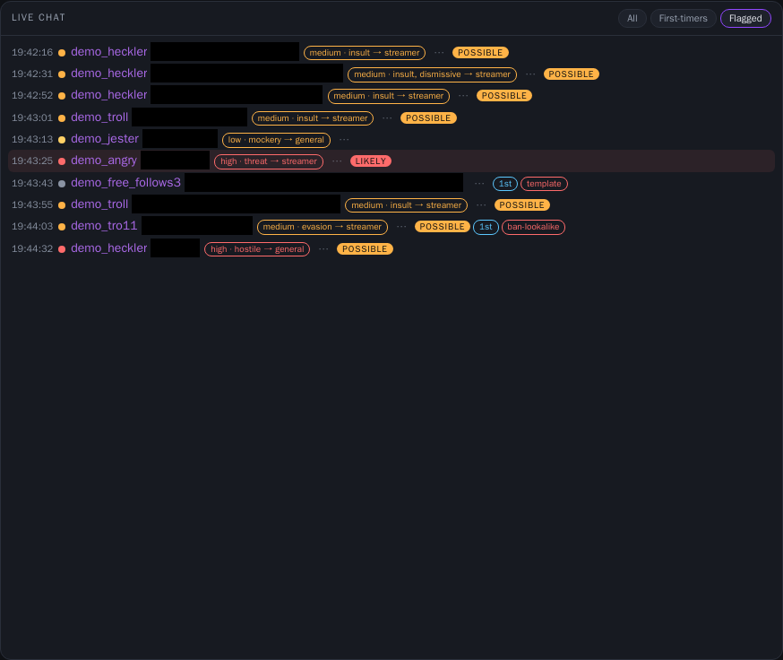
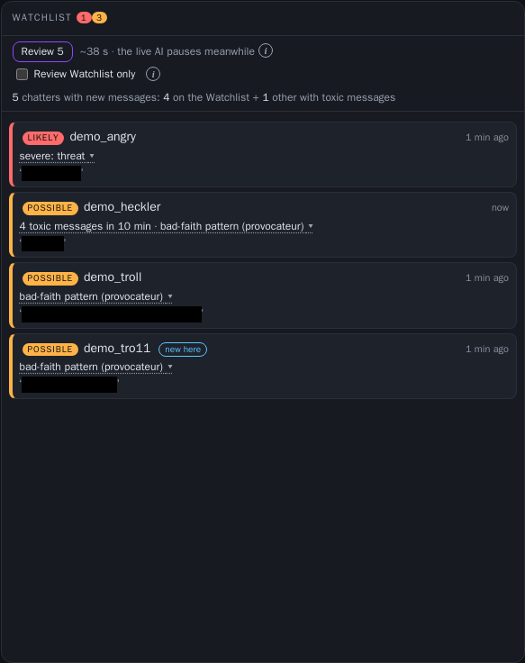
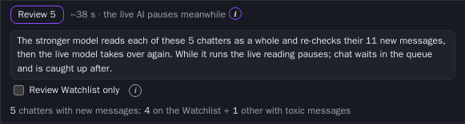
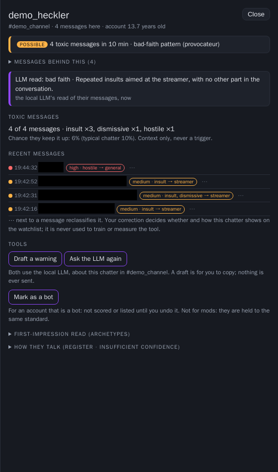

# chatwatch

**A local dashboard for Twitch moderators.** It reads one channel's public chat and shows, live, which messages are
toxic and which chatters are worth a look, with the reasons.



**Built on AI models that run on your own computer.**
- **Every message:** small, fast models read each message as it arrives. They are `unbiased-toxic-roberta` (an ONNX
  encoder) with a toxicity head trained for this tool, and `all-MiniLM-L6-v2`, which matches a chatter's way of
  talking to known patterns.
- **The flagged ones:** a local language model, **Gemma 4** (Google), re-reads flagged messages and reads each flagged
  chatter as a whole. Its reads decide the Watchlist.
  - You choose the size that suits your machine: **Gemma 4 31B**, **Gemma 4 12B** or **Gemma 4 E4B**, or the
    **12B + 31B Hybrid**.
  - Ollama runs them, each with a small draft model (MTP) that makes it faster.
- **No AI:** chatwatch also works without the language model, with word lists and the small models only.

<!-- two lists -->
- **Runs on your machine.** The AI models run locally; no chat or chatter data leaves your computer.
- **Flags with reasons.** Every flagged message says what it is (an insult, a threat, mockery, spam...) and who it is
  aimed at; every chatter on the Watchlist says why they are there.
- **Never acts.** It reads chat anonymously and cannot post, time out or ban. Every flag is a prompt for a human.

chatwatch is not affiliated with or endorsed by Twitch.

> **Content warning.** To recognise slurs and hate codes, `src/chatwatch/assets/coded_lexicon.json`,
> `coded_glossary.json`, the keyword cues in `src/chatwatch/cues.py` and the tests (`tests/`) contain offensive terms in
> plain text.

**Contents:** [Quick start](#quick-start) · [A tour of the dashboard](#a-tour-of-the-dashboard) ·
[How accurate it is](#how-accurate-it-is) · [How it works](#how-it-works) · [Requirements](#requirements) ·
[Everyday use](#everyday-use) · [Settings](#settings) · [Privacy and responsible use](#privacy-and-responsible-use)

## Quick start
Downloads for each system are on the [Releases](https://github.com/cyber31415/chatwatch/releases) page.

**Windows 10 or 11:** download `chatwatch-<version>-windows.zip`, extract it, and double-click
**Start chatwatch.cmd**. The first time, it sets up WSL2's Ubuntu (it asks you to choose an Ubuntu username and
password); after that it just starts. The page opens in your browser. Ctrl+C in its window stops chatwatch and gives
the memory back to Windows. More in [Windows (WSL2)](#windows-wsl2).

**Linux:** it needs podman 4.0 or later, which `start.sh` does not install. Install it first:
- Ubuntu or Debian: `sudo apt install podman iptables`
- Fedora: `sudo dnf install podman`
- Arch: `sudo pacman -S podman`

Then:
```
git clone https://github.com/cyber31415/chatwatch.git && cd chatwatch
./start.sh                                     # builds its image, starts the AI container
```
Then open **http://127.0.0.1:8765**. A release's `chatwatch-<version>-linux.tar.gz` holds the same files. With an Nvidia
GPU, set up podman's CDI once (see [Requirements](#requirements)). The models it downloads stay inside its folder
(`models/`), so deleting the folder removes them. Its two container images are in podman's own storage (`podman rmi`).

**Both:** the first start downloads everything except the AI models and starts with **No AI** (word lists and a small
toxicity model), which works straight away: type a channel and press **Start**. The AI models are big downloads
(6-20 GB), so none is downloaded until you choose one: the AI panel lists the setups that fit your machine; press
**Download** on one (the page shows its progress), then **Use this**.

## A tour of the dashboard
The screenshots use invented chat (every chatter is `demo_...`) run through the real engine. The text of each flagged
message is covered with a black box.

### 1. Choose the AI


While stopped, the AI panel shows what this machine has and every setup that fits it:
- **Accuracy** is how well a setup marks toxic messages and picks out bad-faith chatters, as a gain over No AI.
- **msgs/min** is the busiest chat it keeps up with. Speeds in *italics* are estimates; press **Check Speed** (1-3
  minutes) to measure a model on your machine. The ones above were measured.
- **Measure the channel's chat rate** (or type it) and the panel marks the setup that suits that chat. Up to about 40
  msgs/min the Gemma 4 31B is the most accurate; busier chat suits the **12B + 31B Hybrid**.

**What each setup needs.** A GPU is fastest, but it is not required:
- a model that does not fit in the GPU's memory is split, with the rest in system RAM (slower);
- with no GPU, a model runs from system RAM on the CPU (slowest).

The panel offers only what fits your machine, from what it reads at start.

| setup | download | where it runs | smallest machine it is offered on |
|---|---|---|---|
| Gemma 4 31B | 19.8 GB | split between GPU and RAM: on a 12 GB GPU about half of it sits in RAM (it needs about 14 GB of RAM free). Not offered without a GPU | 8 GB GPU, 32 GB RAM |
| 12B + 31B Hybrid | 27.8 GB (both) | as the 31B, with the 12B beside it; both stay in memory | 8 GB GPU, 32 GB RAM |
| Gemma 4 12B | 8.0 GB | whole on a 12 GB GPU; split on an 8 GB GPU; or on the CPU from RAM (about 9 GB) | no GPU, 32 GB RAM |
| Gemma 4 E4B | 6.3 GB | whole on an 8 GB GPU; or on the CPU from RAM (about 7 GB) | no GPU, 16 GB RAM |
| No AI | none | the CPU: word lists and the small models | any |

### 2. The AI bar


Once running, the panel folds into one line: the setup in use and its speed. Here the Hybrid's fast 12B reads every
message live and the 31B reviews on demand; both models are in memory, so a review's model swap takes about 8 seconds.

### 3. Live chat


Every message, as it arrives:
- **Level and reason:** low, medium or high, what kind (insult, threat, mockery, hostile...) and who it is aimed at
  (the streamer, a chatter, everyone).
- **Watchlist tag:** "likely" or "possible" beside anyone on the Watchlist.
- **Warning chips:** a first message (`1st`), a `template` posted by several new accounts, a `ban-lookalike` of an
  account that was just banned.
- **Moderator actions** (bans, timeouts) appear as context.
- The **⋯** beside a message lets you reclassify it by hand; your correction steers your Watchlist only.

### 4. The Flagged filter


**Flagged** keeps only the messages with a level or a warning chip, and everything said by people on the Watchlist.
**First-timers** keeps the first messages of new chatters.

### 5. The Watchlist


The chatters worth a look right now:
- **likely** (red): sure content, such as a threat or a slur.
- **possible** (amber): a pattern, such as several toxic messages in a few minutes or a bad-faith way of talking.

Each card shows its reasons and the message behind them; open the reasons for every message that counted.

### 6. Review (12B + 31B Hybrid)


In the Hybrid, **Review** has the stronger 31B re-check the flagged chatters. The box says how long it takes and who
it covers (the Watchlist plus everyone else with a toxic message). While it runs, the live reading pauses; chat waits
in the queue and is caught up after. Tick **Review Watchlist only** for fewer chatters and a shorter pause. The **(i)**
buttons explain both.

### 7. A chatter's card


Click any name for their card: why they are listed, the AI's read of them as a person, their toxic messages, and tools
(a warning draft for you to copy, ask the AI again, mark as a bot). Nothing is ever posted for you.

## How accurate it is
Measured on held-out real Twitch chat against the consensus of two independent AI judges (Claude Opus). Details and
caveats: [docs/QUALITY.md](docs/QUALITY.md).

| setup | accuracy (gain over No AI) | msgs/min it keeps up with* |
|---|---|---|
| Gemma 4 31B | +66% | ~40 |
| 12B + 31B Hybrid (Review covering all flagged chatters) | +62% | ≥150 live |
| Gemma 4 12B | +50% | ≥150 |
| Gemma 4 E4B | +37% | ≥150 |
| No AI (word lists and the small models) | +0% | any |

\* Tested on a machine with a 12 GB Nvidia GPU and 96 GB of system memory.

With no GPU, the E4B on a laptop with 16 GB of RAM keeps up with about 10 msgs/min (measured).

With the 31B on quiet chat it catches about 3 in 4 toxic messages (recall 0.74) at precision 0.64.

## How it works
1. **A fast first pass** on every message: word and pattern lists (slurs count in any spelling) and a small toxicity
   model (an ONNX encoder plus a head trained for this tool).
2. **A local language model** (Gemma 4, through Ollama) re-reads messages and reads each flagged chatter as a whole.
   Its reads decide the Watchlist.
3. **Nothing is dropped:** when chat is busier than the model, the queue catches up after (the page says how far
   behind it is).

## Requirements
- **Linux with podman 4.0 or later**, and the usual command-line tools (bash, curl, coreutils, util-linux, iptables).
  Everything else runs in containers; nothing is installed on the host. **Windows 10 or 11** runs it inside WSL2
  (see [Windows (WSL2)](#windows-wsl2)).
- **A GPU is recommended:** Nvidia (with podman's CDI set up: `sudo nvidia-ctk cdi generate --output=/etc/cdi/nvidia.yaml`)
  or AMD (ROCm). It also runs on the CPU, slowly.
- **Disk:** about 4-6 GB for the containers (Ollama's image is most of it), plus the models you download (the 31B
  about 20 GB, the 12B about 8 GB).
- **RAM:** 16 GB is the lowest option; the 31B on a 12 GB GPU needs about 14 GB free.

Tested on an Nvidia GPU + AMD CPU system and an AMD GPU + AMD CPU system (Linux), and an Intel laptop with no GPU and
16 GB of RAM (Windows 11, WSL2). The dashboard reads your GPU memory and system RAM itself; other hardware uses
estimates until you press **Check Speed**. macOS is not supported.

### Windows (WSL2)
chatwatch runs in WSL2's Linux, unchanged; the page opens in your normal Windows browser. WSL itself must be installed
once: if it is not, open PowerShell as administrator, run `wsl --install --no-distribution` and restart the PC.

**With the launcher** (the release's `chatwatch-<version>-windows.zip`, or `windows\` in this repository), double-click
**Start chatwatch.cmd**. Windows may ask whether to run a file from the internet: choose Run. Each step is done once:
1. **WSL's memory.** WSL's default is half your RAM, too little for the AI models, so it raises WSL's limit in
   `C:\Users\<you>\.wslconfig` to your RAM minus 3 GB. It asks first and keeps a copy of the old file. This is a
   limit, not a reservation: Windows keeps what WSL does not use.
2. **Ubuntu 24.04**, where you choose a username and password.
3. **podman and chatwatch** inside Ubuntu, in `~/chatwatch` (it asks for that password).
4. **It starts chatwatch** and opens the page. **Ctrl+C** stops chatwatch, then stops Ubuntu (and WSL, when nothing
   else runs in it), so all the memory goes back to Windows.

**By hand** (PowerShell, then Ubuntu):
1. Put `[wsl2]` and `memory=12GB` (your RAM minus 3 or 4 GB) on two lines in `C:\Users\<you>\.wslconfig`, then run
   `wsl --shutdown`.
2. `wsl --install -d Ubuntu-24.04`
3. In Ubuntu: `sudo apt update && sudo apt install -y podman git curl iptables`
4. `cd ~ && git clone https://github.com/cyber31415/chatwatch.git && cd chatwatch && ./start.sh`. Keep it in Ubuntu's
   own disk, not a Windows folder under `/mnt/c`, where models load slowly.
5. Open **http://127.0.0.1:8765** in your Windows browser. Ctrl+C stops chatwatch and its AI container. WSL itself
   keeps some memory until it shuts down: `wsl --shutdown` in PowerShell gives it all back.

Inside WSL the Windows desktop and browser use memory outside Linux, so the AI panel keeps only the dashboard's share
free beside a model. An Nvidia GPU should work through WSL's CUDA support (set up podman's CDI as above) but is
untested; an AMD GPU under WSL is not supported.

## Everyday use
```
./start.sh                   # start (then open http://127.0.0.1:8765)
./start.sh --no-llm          # without the AI: word lists and the small model only
./start.sh --log             # keep a session log of this run (see Privacy)
CW_PORT=8766 ./start.sh      # another port
bin/ollama.sh stop           # free the GPU and RAM the AI container holds
bin/ollama.sh install TAG    # a model download from a terminal (the same as the page's Download button)
```
Ctrl+C stops the dashboard; the AI container keeps its model in memory for the next start (on Windows it stops too, so
the memory goes back to Windows). One dashboard at a time, one channel per session: to watch another channel, Stop,
then Start.

While it runs it leaves room for the rest of your machine: two CPU cores, and on a GPU that drives your screen 1.5 GB
of its memory (see Settings).

## Settings
Environment variables, or lines in `~/.config/chatwatch/gpu.env` (`NAME=value`; the environment wins):

| variable | default | what it does |
|---|---|---|
| `CW_PORT` | 8765 | the dashboard's port (on 127.0.0.1) |
| `CW_GPU` | detected | `nvidia`, `amd` or `cpu` for the AI container |
| `CW_OLLAMA_PORT` | 11435 | the AI container's port (on 127.0.0.1) |
| `CW_OLLAMA_STORE` | `models/ollama` | where the AI models are kept |
| `CW_KEEP_CORES` | 2 | CPU cores the AI leaves free for the rest of the machine (0: none) |
| `CW_VRAM_RESERVE_GB` | 1.5 | on a GPU that drives your screen: GPU memory a model that fills the GPU leaves free |
| `CW_SESSION_KEEP_DAYS` | 14 | session logs older than this are deleted at start (0: keep) |
| `CW_KEEP_AI` | (unset) | Windows, started by hand in Ubuntu: 1 keeps the AI container and its model loaded after Ctrl+C, as on Linux (the launcher always stops Ubuntu) |

## Privacy and responsible use
- It logs in anonymously (read-only), sees only what any viewer sees, and never posts.
- Besides Twitch's chat connection and the one-time model downloads, it fetches the watched channel's emote sets from
  7TV, BetterTTV and FrankerFaceZ (sending the channel's Twitch id), so it can tell emotes from words.
- **Session logs are off by default.** With `--log`, a run's raw chat lines (with usernames) and the tool's reads are
  kept in `data/sessions/`, and deleted after `CW_SESSION_KEEP_DAYS`.
- The running state (`data/state/`) holds per-chatter sums for the channels you watched. To forget a chatter:
  `bin/cw python -m chatwatch.forget USER_ID --go` (without `--go` it only reports).
- Use it for your own channel or one you moderate, for moderators only. Never show its reads to chatters or on stream:
  they are probabilistic first impressions of what someone is doing in chat, not judgements of who they are.
- More in [docs/RESPONSIBLE_USE.md](docs/RESPONSIBLE_USE.md): the defaults, the known bias risks and why.

## Files
- `start.sh` the launcher; `bin/` the container wrapper (`cw`), the AI container (`ollama.sh`), its log copier, and the
  helper that runs the page's model downloads (`install_helper.sh`).
- `windows/` the Windows launcher (`Start chatwatch.cmd`, `chatwatch.ps1`, and `setup_wsl.sh`, its part inside WSL): a
  release's Windows zip holds these three files.
- `src/chatwatch/` the dashboard (Python); `web/index.html` its page.
- `data/models/` the small models trained for this tool (the toxicity head, the cold-start and chatter-type models).
- `models/drafts/` the MTP Modelfiles and the drafter download list.
- `tests/` the tests (`pytest`), and `tests/web/` the page's browser checks.
- `docs/` accuracy details, responsible use, and the screenshots.

## Licence
Apache-2.0 ([LICENSE](LICENSE)). The models it downloads keep their own licences ([NOTICE](NOTICE)).
